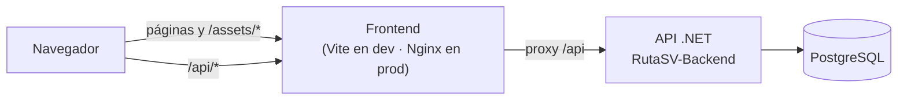
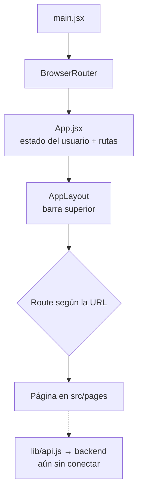

# RutaSV Frontend · Manual del equipo

Este documento reúne todo lo que necesitas para trabajar en la interfaz de **RutaSV**: cómo ponerla a funcionar en tu equipo, cómo está organizado el código, cómo hablará con el backend y qué revisar antes de subir cambios. No hace falta saber React para empezar; las ideas básicas están explicadas al inicio.

> Este manual describe el estado actual de la rama **`develop`**.

---

## 1. Ideas básicas antes de empezar

* **React.** Es la librería con la que armamos la interfaz. En vez de páginas HTML enteras, construimos **componentes**: piezas pequeñas (un botón, una tarjeta, un formulario) que se combinan para formar cada pantalla. Cada componente es una función que devuelve **JSX**, que se parece a HTML pero vive dentro de JavaScript.
* **SPA (aplicación de una sola página).** El navegador descarga un único `index.html` y React cambia lo que se muestra según la URL, sin recargar. Por eso moverse por la app se siente inmediato.
* **Node y npm.** Node ejecuta JavaScript fuera del navegador; lo necesitamos para compilar el proyecto. npm descarga las librerías y lanza los comandos del día a día (`npm run dev`, `npm test`…).
* **Vite.** Es la herramienta que compila y sirve el proyecto mientras desarrollas. Cada vez que guardas un archivo, la página se actualiza sola.
* **React Router.** Decide qué pantalla corresponde a cada URL. Hoy las rutas se declaran en `src/App.jsx`.
* **Tailwind CSS.** Los estilos se escriben como clases dentro del propio JSX (`className="flex gap-4 p-6"`), sin hojas CSS aparte.
* **Proxy `/api`.** El código del front pedirá los datos a `/api/...`. Vite (en desarrollo) o Nginx (en producción) reenvía esas peticiones al backend. Así no hay problemas de CORS ni direcciones del backend escritas en el código.
* **Docker.** Empaqueta la app ya compilada con Nginx dentro de un contenedor. En el trabajo diario no lo necesitas; se usa para probar la imagen de producción y lo ejecuta el CI.
* **`.env`.** Archivo de texto con ajustes locales (puertos, dirección del backend). Cada persona tiene el suyo y no se sube a Git.

---

## 2. Qué necesitas instalado

1. **Git** — [git-scm.com](https://git-scm.com/).

2. **Node 22 o superior** — [nodejs.org](https://nodejs.org/). Compruébalo con `node -v`.

3. **VS Code** — [code.visualstudio.com](https://code.visualstudio.com/), con estas extensiones:

   * ESLint (`dbaeumer.vscode-eslint`)

   * Tailwind CSS IntelliSense (`bradlc.vscode-tailwindcss`)

   * *(opcional)* ES7+ React snippets

4. **Docker Desktop** — solo si quieres probar la imagen de producción.

5. **El backend en marcha** — cuando toque conectar el front con datos reales (sigue el README de `RutaSV-Backend`).

---

## 3. Primer arranque

### 3.1 Clona el repositorio

```bash
git clone https://github.com/RaquelVentura/RutaSV-Frontend
cd RutaSV-Fronted
```

### 3.2 Trabaja siempre en tu propia rama

> ⚠️ **Regla del equipo:** no se programa directamente en `main` ni en `develop`. Cada tarea o historia de usuario tiene su rama.

Si la rama ya existe en GitHub:

```bash
git fetch origin
git checkout nombre-de-tu-rama
git pull origin nombre-de-tu-rama
```

Si vas a empezar una tarea nueva (ejemplo HU-02):

```bash
git checkout develop
git pull origin develop
git checkout -b feature/HU-02-descripcion-corta
```

### 3.3 Instala las librerías

```bash
npm install
```

Crea la carpeta `node_modules`. La primera vez puede tardar un par de minutos.

### 3.4 Crea tu `.env`

Copia la plantilla incluida en el repo:

```bash
cp .env.example .env              # Git Bash, Linux o macOS
```

```powershell
Copy-Item .env.example .env       # Windows PowerShell
```

| Variable | Valor por defecto | Función |
| :--- | :--- | :--- |
| `VITE_API_PROXY_TARGET` | `http://localhost:8080` | A dónde reenvía Vite las peticiones `/api` con `npm run dev` |
| `API_UPSTREAM` | `http://host.docker.internal:8080` | A dónde las reenvía Nginx con `docker compose up` |
| `FRONTEND_PORT` | `5173` | Puerto con el que se publica el contenedor |

Este archivo está en `.gitignore`, así que tus valores no se suben a GitHub.

### 3.5 Arranca la app

```bash
npm run dev
```

Abre **http://localhost:5173** (o la dirección que imprima la consola). Edita cualquier archivo de `src/`, guarda con `Ctrl + S` y verás el cambio al instante. Para detenerla: `Ctrl + C`.

---

## 4. Dos formas de trabajar

**A. En tu equipo, con `npm run dev` (la de todos los días).** Es la más rápida: recarga al guardar. Hoy el front aún no consume el backend, así que no necesitas tenerlo encendido.

**B. Imagen de producción.** Para comprobar lo que realmente se despliega:

```bash
docker compose up --build     # abre http://localhost:5173
docker compose down           # para apagarlo
```

---

## 5. Cómo está organizado el código

```
RutaSV-Fronted/
├── index.html                  Página única con <div id="root">
├── package.json                Dependencias y scripts
├── vite.config.js              Plugins (React, Tailwind), proxy /api y config de pruebas
├── eslint.config.js            Reglas del linter
├── .editorconfig               Formato: UTF-8, LF, 2 espacios
├── .env / .env.example         Ajustes locales (.env no se sube)
├── .nvmrc                      Versión de Node (22)
├── Dockerfile                  Compila y sirve con Nginx
├── docker-compose.yml          Levanta solo el front
├── nginx.conf.template         Nginx: SPA + proxy /api
├── .github/workflows/ci.yml    Integración continua
├── public/                     Archivos estáticos (favicon.svg)
├── dist/                       Resultado del build (se genera solo)
└── src/                        ← aquí se trabaja
    ├── main.jsx                Punto de entrada: monta <App /> dentro de <BrowserRouter>
    ├── App.jsx                 Rutas de la aplicación y estado del usuario
    ├── App.test.jsx            Pruebas de las rutas
    ├── index.css               Importa Tailwind
    ├── layouts/
    │   ├── AppLayout.jsx       Barra superior (logo, iniciar sesión / registro / cerrar sesión) y contenedor
    │   └── AppLayout.test.jsx
    ├── pages/                  Una pantalla por archivo
    │   ├── Home.jsx            Portada
    │   ├── NotFound.jsx        Página 404
    │   └── Auth/
    │       ├── Login.jsx / Login.test.jsx   Inicio de sesión
    │       ├── Registration.jsx             Registro
    │       ├── EmailVerification.jsx        Ingreso del código de 6 dígitos
    │       └── VerificationResult.jsx       Resultado: aceptada o rechazada
    ├── lib/
    │   └── api.js              apiFetch: función base para hablar con el backend
    └── test/setup.js           Preparación de las pruebas (jest-dom)
```

### ¿Dónde pongo mi código?

| Si necesito… | Lo hago en… |
| :--- | :--- |
| Una pantalla nueva | `src/pages/NombrePagina.jsx` y la registro como `<Route>` en `src/App.jsx` |
| Una pantalla de autenticación | `src/pages/Auth/` |
| Algo que se repite en varias pantallas (barra, pie de página) | `src/layouts/` |
| Una pieza reutilizable (tarjeta, modal, calendario) | crear `src/components/` y ponerla ahí |
| Pedir datos a la API | `apiFetch` de `src/lib/api.js`; mis funciones propias, en `src/lib/` |
| Una prueba | Junto al archivo: `Algo.test.jsx` |

Nombres: componentes y páginas en `PascalCase.jsx`; utilidades en `camelCase.js`.

### De HTML/CSS a React

Si ya tienes una vista hecha con HTML y CSS, esta es la equivalencia:

| HTML / CSS | En este proyecto |
| :--- | :--- |
| `class="..."` | `className="..."` |
| `<a href="/x">` | `<Link to="/x">` (de `react-router-dom`) |
| `<input>` | `<input />` (todo elemento se cierra) |
| `for="id"` | `htmlFor="id"` |
| Archivo `.css` | Clases de Tailwind (`flex gap-4 p-6 text-lg`) |
| `@media (min-width: 768px)` | Prefijo `md:` (`md:flex-row`) |
| Bloques HTML repetidos | Un componente + `.map()` |
| `onclick="..."` | `onClick={() => ...}` |

---

## 6. Arquitectura

### 6.1 Panorama general



El navegador solo conversa con el frontend; este sirve la aplicación y reenvía `/api/*` al backend.

### 6.2 Recorrido de una pantalla



### 6.3 Rutas actuales (`src/App.jsx`)

| Ruta | Pantalla |
| :--- | :--- |
| `/` | Portada (`Home`). Cambia si hay usuario: saludo o botones de iniciar sesión / crear cuenta |
| `/login` | Inicio de sesión (`Login`) |
| `/registro` | Registro (`Registration`) |
| `/registro/verificar` | Código de verificación de 6 dígitos (`EmailVerification`) |
| `/registro/verificacion/aceptada` | Resultado positivo (`VerificationResult accepted`) |
| `/registro/verificacion/rechazada` | Resultado negativo (`VerificationResult accepted={false}`) |
| `*` | Página no encontrada (`NotFound`) |

Cómo funciona hoy:

* `App.jsx` guarda `user` con `useState` (arranca en `null`) y lo pasa a `AppLayout` y a `Home`. `AppLayout` muestra "Hola, nombre" y **Cerrar sesión** si hay usuario, o los enlaces **Iniciar sesión** y **Registro** si no.
* Las pantallas de login, registro y verificación validan los campos en el navegador y avisan con mensajes en pantalla, pero **todavía no llaman al backend**. Los textos lo indican ("requieren conectar el backend").
* Aún no hay rutas protegidas por rol ni persistencia de sesión: al recargar, `user` vuelve a `null`.

### 6.4 Validaciones de formularios

Los formularios usan estado de React (`useState`) y la validación nativa del navegador (`input.validity`). Ejemplos ya hechos:

* **Login:** correo y contraseña obligatorios; el correo debe tener formato válido.
* **Registro:** nombre, correo y contraseña obligatorios; contraseña de al menos 8 caracteres; confirmación igual a la contraseña. Al enviar sin errores navega a `/registro/verificar` pasando el correo.
* **Verificación:** el código debe tener exactamente 6 dígitos.

Si necesitas validar otro formulario, copia ese patrón: un objeto `errors`, un `handleSubmit` que lo llena y foco en el primer campo con error.

### 6.5 Estilos

Hoy se usan las clases estándar de Tailwind (`bg-stone-50`, `rounded-full`, `text-stone-600`…) y el color de marca **`#087E9A`** escrito directamente (`bg-[#087E9A]`, `text-[#087E9A]`; su hover es `hover:bg-cyan-800`). `src/index.css` solo importa Tailwind. Para mantener la coherencia visual, usa estos mismos colores en las pantallas nuevas.

---

## 7. Cómo se conectará con el backend

El backend está hecho en **.NET 10** con capas (`Api`, `Application`, `Domain`, `Infrastructure`) y PostgreSQL 18. Su documentación detallada está en el README de `RutaSV-Backend`.

Lo que ya existe en el front para esa conexión es `src/lib/api.js`: `apiFetch(path, options)` antepone `/api` a la ruta, pide JSON y lanza un `Error` si la respuesta no es exitosa. Aún no envía el token ni interpreta los errores del backend; eso se añadirá al conectar el login.

### Endpoints de autenticación que ya existen en el backend (`api/auth`)

| Método | Ruta | Cuerpo (JSON) | Respuesta |
| :--- | :--- | :--- | :--- |
| POST | `/api/auth/register` | `{ email, password, firstName, lastName, phone? }` | `AuthResponse` · errores 400 y 409 (usuario existente) |
| POST | `/api/auth/login` | `{ email, password }` | `AuthResponse` · errores 400 y 401 |
| POST | `/api/auth/google` | `{ idToken }` | `AuthResponse` · errores 400 y 401 |
| POST | `/api/auth/verify-email` | `{ token }` | `{ message }` · error 400 |

Forma de `AuthResponse`:

```json
{
  "id": "guid",
  "email": "usuario@correo.com",
  "firstName": "Nombre",
  "lastName": "Apellido",
  "role": "VISITANTE",
  "emailVerified": false,
  "token": "jwt..."
}
```

Roles: `ADMIN`, `OPERADOR`, `VISITANTE`.

### ⚠️ Puntos por resolver al conectar front y back

1. **Prefijo `/api`.** El backend expone `/api/auth/login`, pero el proxy del front (`rewrite` en `vite.config.js` y en `nginx.conf.template`) quita `/api` antes de reenviar, así que la petición llegaría como `/auth/login` y daría 404. Lo más simple es eliminar ambos `rewrite`.

2. **Puerto.** `.env.example` apunta a `8080`; el backend de desarrollo en Docker usa `5000`.

3. **Campos distintos.** El formulario de registro pide un solo campo `name`; el backend espera `firstName` y `lastName`.

4. **Verificación de correo.** La pantalla del front pide un código de 6 dígitos; el endpoint del backend recibe un `token`. Hay que acordar si es código numérico o enlace.

5. **Roles en el backend.** Por ahora ningún controlador usa `[Authorize(Roles = ...)]` (HU-07 está en curso).

---

## 8. Comandos de uso diario

| Comando | Qué hace | Cuándo |
| :--- | :--- | :--- |
| `npm install` | Instala las librerías | Al clonar o si alguien agregó una |
| `npm run dev` | Levanta el servidor de desarrollo | Mientras programas |
| `npm run lint` | Revisa el código con ESLint | **Antes de cada PR** |
| `npm test` | Corre las pruebas una vez | **Antes de cada PR** |
| `npm run test:watch` | Repite las pruebas al guardar | Mientras escribes tests |
| `npm run build` | Genera la versión de producción en `dist/` | Para comprobar que compila |
| `npm run preview` | Sirve `dist/` en local | Para probar el build |
| `npm ci` | Instalación limpia según el lock | Lo usa el CI |
| `docker compose up --build` | Levanta la imagen de producción | Para probar Docker |
| `docker compose down` | Apaga el contenedor | Al terminar |

**Traer lo último de `develop` a tu rama sin cambiarte de rama:**

```bash
git add . && git commit -m "wip"
git fetch origin
git merge origin/develop
# si hay conflictos: editar, git add ., git commit
npm install && npm run lint && npm test
git push
```

**Si aparece un conflicto:** abre el archivo, deja el código que debe quedar y borra las marcas `<<<<<<<`, `=======` y `>>>>>>>`; después `git add .` y `git commit`. Para cancelar todo: `git merge --abort`.

---

## 9. Antes de hacer `git push`

El CI de GitHub Actions ejecuta lo mismo que puedes correr tú. Antes de subir o abrir un Pull Request hacia `develop`, lanza estos tres comandos desde la raíz del proyecto:

```bash
npm run lint     # estilo y errores de código
npm test         # pruebas
npm run build    # el proyecto compila
```

Si los tres pasan en tu máquina, el pipeline saldrá en verde.

### Qué hace el CI (`.github/workflows/ci.yml`)

Se dispara con cada **Pull Request** hacia `develop` o `main` y con cada **push** a esas ramas. Un push a una rama `feature/*` sin PR no lo activa.

| Job | Pasos |
| :--- | :--- |
| `Lint, pruebas y build` | `npm ci` → `npm run lint` → `npm test` → `npm run build` |
| `Construir imagen Docker` (solo si el anterior pasa) | Construye la imagen, la publica en GitHub Container Registry (`latest` y `sha-<commit>`) y hace una prueba de humo: `/` y `/experiencias` deben devolver `index.html` |

---

## 10. Docker y Nginx

La imagen se construye en dos etapas (`Dockerfile`):

1. **Compilación:** `node:22-alpine` ejecuta `npm ci` y `npm run build`, que produce `dist/`.

2. **Ejecución:** `nginxinc/nginx-unprivileged:alpine` sirve `dist/` por el puerto interno **8080**, sin privilegios de administrador.

| Ruta en Nginx | Comportamiento |
| :--- | :--- |
| `/assets/*` | Archivos de Vite con hash en el nombre; caché de 1 año |
| `/api/*` | Proxy hacia el backend (ver el punto 1 de la sección 7) |
| cualquier otra | Devuelve `index.html` para que React Router resuelva la ruta; por eso `/login` funciona al recargar |

Nginx añade cabeceras de seguridad y admite subidas de hasta 10 MB. La imagen se configura con `API_UPSTREAM` (por defecto `http://api:8080`), `PORT` (`8080`) y `DNS_RESOLVER` (`127.0.0.11`).

---

## 11. Calidad de código y pruebas

* **`.editorconfig`:** UTF-8, saltos LF, sangría de 2 espacios y línea final obligatoria.
* **ESLint** (`eslint.config.js`): reglas recomendadas de JavaScript, hooks de React y React Refresh, más una regla de nombres: variables y parámetros en `camelCase` (también `PascalCase` para componentes y objetos), funciones en `camelCase` o `PascalCase`, clases en `PascalCase`.
* **Pruebas:** Vitest con Testing Library y `jest-dom` sobre jsdom. Hay pruebas en `App.test.jsx`, `AppLayout.test.jsx` y `Login.test.jsx`. Cada prueba nueva va junto a su archivo (`*.test.jsx`).

---

## 12. Si algo falla

| Síntoma | Qué hacer |
| :--- | :--- |
| `npm: command not found` | Instala Node 22 y abre una terminal nueva |
| `Cannot find module ...` | Ejecuta `npm install` |
| El puerto 5173 está ocupado | Cierra el otro servidor o acepta el puerto que propone Vite |
| Las llamadas a `/api` dan 404 o 502 | Backend apagado, `VITE_API_PROXY_TARGET` mal puesto o el tema del prefijo `/api` (sección 7) |
| El CI falla en tu PR | Corre `npm run lint`, `npm test` y `npm run build` en local y corrige |
| Ves cambios de otra rama | `git status` y `git switch` a la rama correcta antes de seguir |
