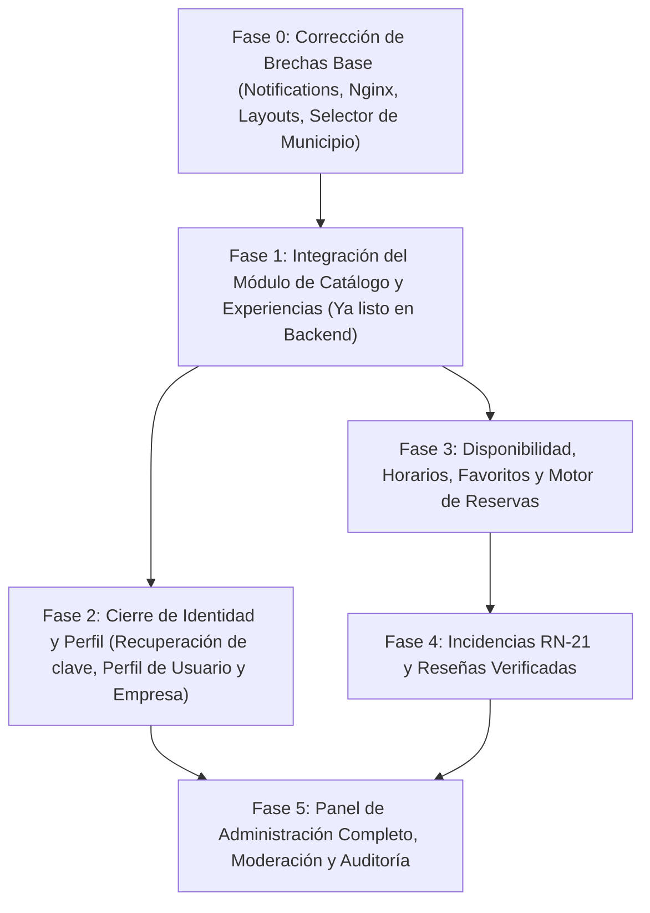

# Brechas Técnicas, Cobertura de Pruebas y Hoja de Ruta del Frontend

> Auditoría de los problemas técnicos, inconsistencias de arquitectura y deudas de UX encontrados en el código actual de `RutaSV-Frontend`, junto con el estado de la suite de pruebas en Vitest y el plan de acción priorizado para las próximas iteraciones.

---

## 1. Brechas Técnicas y de UX Detectadas en lo Ya Desarrollado

### Brecha 1 (Alta): `<Notifications />` (`Toaster` de Sonner) no está montado en la aplicación
* **Ubicación:** [`src/components/Notifications.jsx`](../../src/components/Notifications.jsx), [`src/lib/notify.js`](../../src/lib/notify.js), [`src/App.jsx`](../../src/App.jsx) y [`src/pages/Profile/Profile.jsx`](../../src/pages/Profile/Profile.jsx#L89).
* **Problema:** `Profile.jsx` llama a `notify.success('Cambios guardados.')`, y existe el componente `<Notifications />` con sus propias pruebas unitarias (`Notifications.test.jsx`), pero **`<Notifications />` no se renderiza en `App.jsx` ni en ningún layout**. En consecuencia, ninguna notificación toast aparece visualmente en la aplicación.
* **Solución:** Importar y renderizar `<Notifications />` dentro de `App.jsx` (junto a `<AppRoutes />`).

---

### Brecha 2 (Alta): Regla `rewrite` en `nginx.conf.template` rompe el proxy `/api/` en Docker
* **Ubicación:** [`nginx.conf.template`](../../nginx.conf.template#L23-L25) y [`.env.example`](../../.env.example#L4).
* **Problema:** En `nginx.conf.template` se configuró:
  ```nginx
  location /api/ {
    rewrite ^/api/(.*)$ /$1 break;
    proxy_pass $api_upstream;
  ```
  Mientras que en `.env.example` `API_UPSTREAM=http://host.docker.internal:8080` (y en `Dockerfile` `API_UPSTREAM=http://api:8080`). Como todos los controladores de `RutaSV-Backend` usan `[Route("api/...")]` (`/api/auth/login`, `/api/experiences`, `/api/operator-requests`), al quitar `/api/` en Nginx el backend recibe `/auth/login` y responde **`404 Not Found`**.
* **Solución:** Eliminar la línea `rewrite ^/api/(.*)$ /$1 break;` en `nginx.conf.template` (y en `vite.config.js` usar `target: env.VITE_API_PROXY_TARGET || 'http://localhost:5000'` sin `rewrite`), de modo que `/api/*` se reenvíe íntegro tanto en desarrollo como en producción.

---

### Brecha 3 (Media): `<GoogleOAuthProvider>` duplicado en `main.jsx` y `App.jsx`
* **Ubicación:** [`src/main.jsx`](../../src/main.jsx#L14-L18) y [`src/App.jsx`](../../src/App.jsx#L10-L14).
* **Problema:** Tanto `main.jsx` como `App.jsx` leen `import.meta.env.VITE_GOOGLE_CLIENT_ID` y envuelven el árbol de componentes con `<GoogleOAuthProvider clientId={googleClientId}>`, generando dos proveedores anidados innecesarios.
* **Solución:** Conservar `<GoogleOAuthProvider>` únicamente en `src/App.jsx` (para que los tests que montan `<App />` sigan teniéndolo disponible) y quitarlo de `src/main.jsx`.

---

### Brecha 4 (Media): Doble encabezado y pie de página en vistas de Autenticación y Solicitud de Operador
* **Ubicación:** [`src/router.jsx`](../../src/router.jsx#L66-L103), [`src/pages/Auth/Login.jsx`](../../src/pages/Auth/Login.jsx#L112-L249), [`src/pages/Auth/Registration.jsx`](../../src/pages/Auth/Registration.jsx#L168-L175) y [`src/pages/Operators/OperatorRequestForm.jsx`](../../src/pages/Operators/OperatorRequestForm.jsx#L718-L737).
* **Problema:**
  1. Todas estas rutas están anidadas dentro de `<Route element={<MainLayout />}>`, el cual ya renderiza `<NavBar />` arriba y `<Footer />` abajo.
  2. Sin embargo, `Login.jsx` declara `<div className="min-h-screen ...">`, renderiza su propio encabezado `RutaSV` y su propio `<footer>© 2026 RutaSV...</footer>`, provocando que en pantalla aparezcan **dos barras superiores y dos pies de página**.
  3. De igual forma, `OperatorRequestForm.jsx` renderiza un `<main className="min-h-screen ...">` con una cabecera interna propia que repite el logo `RutaSV` y el avatar con iniciales del usuario, duplicando la información que ya muestra `<NavBar />`.
  4. El componente [`src/components/AuthCard.jsx`](../../src/components/AuthCard.jsx) fue creado para estandarizar las pantallas de autenticación, pero no se usa en `Login.jsx`, `Registration.jsx`, `EmailVerification.jsx` ni `VerificationResult.jsx`.
* **Solución:** Quitar los encabezados/footers internos y el `min-h-screen` de `Login.jsx`, `Registration.jsx`, `EmailVerification.jsx` y `OperatorRequestForm.jsx` (o utilizar `AuthCard.jsx`).

---

### Brecha 5 (Media): `OperatorRequestForm.jsx` envía `municipalityId: null` en lugar de usar el catálogo del Backend
* **Ubicación:** [`src/pages/Operators/OperatorRequestForm.jsx`](../../src/pages/Operators/OperatorRequestForm.jsx#L786-L794) y línea `646`.
* **Problema:** El estado `business` incluye la propiedad `municipalityId`, pero en el JSX del Paso 1 no existe ningún campo ni `<select>` vinculado a `municipalityId`. En su lugar, hay un input de texto libre `area` ("Departamento / zona") que se concatena dentro del string `message` (`"Servicio: ... · Zona: ..."`), enviando siempre `municipalityId: null` al crear una solicitud.
* **Solución:** Ahora que `RutaSV-Backend` ya tiene `GET /api/departments` y `GET /api/departments/{id}/municipalities`, reemplazar el texto libre `area` por dos `<select>` en cascada (Departamento -> Municipio) que guarden el `municipalityId` real en `company.municipalityId`. Además, en `MyOperatorRequest.jsx` y `RequestDetail.jsx`, mostrar el nombre del municipio en vez de `"Municipio ID: 14"`.

---

### Brecha 6 (Media): Sincronización del token en `localStorage` tras verificar el correo electrónico
* **Ubicación:** [`src/pages/Auth/EmailVerification.jsx`](../../src/pages/Auth/EmailVerification.jsx#L72-L81) y [`src/context/AuthContext.jsx`](../../src/context/AuthContext.jsx#L129-L150).
* **Problema:** El endpoint `POST /api/auth/verify-email` del backend responde únicamente `{ message: "..." }` (no devuelve un nuevo token JWT). Cuando `EmailVerification.jsx` ejecuta `markEmailAsVerified(response?.data?.token)`, `AuthContext` actualiza `user.emailVerified = true` en la memoria de React, pero el token guardado en `localStorage` sigue teniendo el claim `email_verified: "false"` hasta que se dispare `refreshSession()` (`/api/auth/me`).
* **Solución:** En `EmailVerification.jsx` (o dentro de `markEmailAsVerified`), invocar `await refreshSession()` tras verificar el correo para que `GET /api/auth/me` emita y persista de inmediato el nuevo JWT con `email_verified: "true"`.

---

### Brecha 7 (Media): Búsqueda en memoria de `RequestDetail.jsx` (`/admin/solicitudes/:id`)
* **Ubicación:** [`src/pages/Admin/RequestDetail.jsx`](../../src/pages/Admin/RequestDetail.jsx#L128-L135).
* **Problema:** Cuando un administrador entra directamente por URL a `/admin/solicitudes/:id` (o recarga la página sin `location.state.request`), `RequestDetail.jsx` llama a `getOperatorRequests({ pageNumber: 1, pageSize: 100 })` y busca el `id` en ese arreglo (`paged.data.find(...)`). Si existen más de 100 solicitudes en la base de datos y la solicitud buscada no está en la primera página de 100, mostrará erróneamente `"Solicitud no encontrada"`.
* **Solución:** Solicitar en `RutaSV-Backend` el endpoint `GET /api/operator-requests/{id:guid}` (rol `ADMIN`) y consumirlo directamente desde `RequestDetail.jsx`.

---

### Brecha 8 (Media): Fragmentación en el cliente HTTP y en el manejo de errores
* **Ubicación:** [`src/config/axios.js`](../../src/config/axios.js), [`src/lib/ApiError.js`](../../src/lib/ApiError.js), [`src/lib/errors.js`](../../src/lib/errors.js), [`src/lib/operatorRequests.js`](../../src/lib/operatorRequests.js#L35-L68), [`src/pages/Auth/Registration.jsx`](../../src/pages/Auth/Registration.jsx#L7-L42) y [`src/pages/Auth/EmailVerification.jsx`](../../src/pages/Auth/EmailVerification.jsx#L6-L41).
* **Problema:**
  1. Existen **tres funciones casi idénticas** para extraer mensajes de error de Axios (`extractBackendErrorMessage` en `operatorRequests.js`, `getApiErrorMessage` en `Registration.jsx` y `getApiErrorMessage` en `EmailVerification.jsx`), mientras que en `src/lib/errors.js` existe `getErrorMessage(error)` basado en `ApiError` que casi no se usa porque `axios.js` no convierte los errores de respuesta en instancias de `ApiError`.
  2. En `operatorRequests.js` (`uploadOperatorRequestDocument`) y en `AuthContext.jsx` (`refreshSession`) se utiliza `fetch()` nativo leyendo manualmente `localStorage.getItem('token')`, en lugar de usar la instancia configurada `api` de Axios.
* **Solución:** Unificar la extracción de errores `ProblemDetails` (incluyendo soporte para `missingFields` de códigos `422` y `errors` por campo de códigos `400`) en `src/lib/errors.js` y reutilizarla en todas las vistas.

---

### Brecha 9 (Media): Fallback silencioso en subida de documentos (`OperatorRequestForm.jsx`)
* **Ubicación:** [`src/pages/Operators/OperatorRequestForm.jsx`](../../src/pages/Operators/OperatorRequestForm.jsx#L544-L566).
* **Problema:** En `resolveDocumentAttachment`, si `uploadOperatorRequestDocument(fileItem.rawFile)` lanza un error (por ejemplo, MinIO caído o error de red), el bloque `catch` ignora el error y genera una ruta ficticia `operator-requests/${userFolder}/${fileItem.name}` que sí se guarda en la base de datos pero **cuyo archivo nunca subió a MinIO**. Luego, en `MyOperatorRequest.jsx` y `RequestDetail.jsx`, la imagen da `404` al intentar previsualizarla. *(Este fallback se puso originalmente para que los tests unitarios pasaran sin mockear `fetch`)*.
* **Solución:** Si estamos en entorno real y `uploadOperatorRequestDocument` falla, propagar el error al usuario para que sepa que la imagen no pudo subirse, y en `OperatorRequestForm.test.jsx` mockear la subida o `uploadOperatorRequestDocument`.

---

### Brecha 10 (Baja): Archivo vacío `src/components/Input.jsx` y clase inválida en `Container.jsx`
* **Ubicación:** [`src/components/Input.jsx`](../../src/components/Input.jsx) y [`src/components/Container.jsx`](../../src/components/Container.jsx).
* **Problema:**
  1. `src/components/Input.jsx` tiene `0 bytes` (archivo vacío sin exportar ningún componente).
  2. `src/components/Container.jsx` define `className={`mx-none w-full px-6 ${className}`.trim()}`. La clase `mx-none` no existe en Tailwind CSS y, a diferencia de `NavBar` o `Footer` (`mx-auto max-w-6xl px-6`), `Container` no centra ni limita el ancho máximo en pantallas grandes (`2xl`), haciendo que las secciones de `Home` se estiren a todo el ancho del monitor.
* **Solución:** Eliminar `src/components/Input.jsx` (o implementarlo formalmente) y definir en `Container.jsx` `mx-auto max-w-6xl w-full px-6` (o permitir ancho completo solo cuando se pase por `className`).

---

### Brecha 11 (Baja): Discrepancia de campos en `Profile.jsx` frente al esquema de Base de Datos
* **Ubicación:** [`src/pages/Profile/Profile.jsx`](../../src/pages/Profile/Profile.jsx#L36-L51).
* **Problema:** `Profile.jsx` incluye el campo obligatorio `publicName` ("Nombre público"), el cual **no existe** en la tabla `app_user` del documento maestro [`RutaSV_Funcionalidades_y_BD.md`](../RutaSV_Funcionalidades_y_BD.md) ni en la entidad `User` de `RutaSV-Backend`. En cambio, la tabla `app_user` sí define `phone` (`varchar(30)`) y `preferred_language` (`varchar(5)` `'es'` / `'en'`).
* **Solución:** Al conectar `Profile.jsx` con el futuro endpoint `PUT /api/users/me`, reemplazar `publicName` por `phone` y `preferredLanguage`.

---

### Brecha 12 (Baja): `README.md` desactualizado y rutas de verificación huérfanas
* **Ubicación:** [`README.md`](../../README.md) y [`src/pages/Auth/VerificationResult.jsx`](../../src/pages/Auth/VerificationResult.jsx).
* **Problema:**
  1. El `README.md` de la raíz del frontend describe una versión inicial del proyecto (menciona `src/layouts/AppLayout.jsx`, `src/lib/api.js`, código de verificación de 6 dígitos y dice que el frontend aún no se conecta al backend).
  2. Las rutas `/registro/verificacion/aceptada` y `/registro/verificacion/rechazada` (`VerificationResult.jsx`) pertenecen al diseño antiguo de código de 6 dígitos; hoy `EmailVerification.jsx` verifica por token y navega directo a `/`.
* **Solución:** Actualizar `README.md` apuntando a `./docs/README.md` y evaluar si se redirige a `VerificationResult` desde `EmailVerification` o si se retiran esas dos rutas cuando se actualicen los tests de `App.test.jsx`.

---

## 2. Estado Actual de Calidad y Pruebas Automatizadas (`Vitest`)

El proyecto cuenta con una suite de pruebas rápida y confiable ejecutada con **Vitest 4 + React Testing Library + jsdom**. Al ejecutar `npx vitest run`, las **15 suites y 89 pruebas pasan al 100 %**.

### 2.1 Inventario de Suites de Prueba Existentes

| Archivo de Prueba | Nº Tests | Qué Cubre Actualmente |
| :--- | :---: | :--- |
| [`src/App.test.jsx`](../../src/App.test.jsx) | **19** | Enrutamiento general, protección por rol (`VISITANTE`, `OPERADOR`, `ADMIN`), flujos locales del Panel de Operador (`experiences`, `availability`, `reservations`, `reviews`, `settings` en `localStorage`), validaciones básicas de login/registro/verificación y 404. |
| [`src/pages/Admin/Admin.test.jsx`](../../src/pages/Admin/Admin.test.jsx) | **15** | `AdminDashboard`, navegación del panel, sincronización del buscador `?q=`, listado de `RequestsQueue` desde `GET /api/operator-requests`, detalle `RequestDetail` y aprobación/rechazo con `POST /api/operator-requests/{id}/review`, más filtro local de `UsersList`. |
| [`src/layouts/MainLayout.test.jsx`](../../src/layouts/MainLayout.test.jsx) | **7** | Renderizado de `NavBar` y `Footer`, menú de usuario según estado de verificación (`Verificar correo`) y cierre de sesión. |
| [`src/pages/Operators/OperatorRequestForm.test.jsx`](../../src/pages/Operators/OperatorRequestForm.test.jsx) | **7** | Wizard de 2 pasos, validaciones requeridas, subida de evidencias, creación (`POST /api/operator-requests`), manejo de error `409 Conflict`, estado vacío en `MyOperatorRequest` y edición/reenvío de solicitud rechazada (`PUT /api/operator-requests/{id}`). |
| [`src/pages/Profile/Profile.test.jsx`](../../src/pages/Profile/Profile.test.jsx) | **6** | Visualización de datos del JWT, CTA para solicitar ser operador (solo visible para `VISITANTE`), validación de campos, cancelar cambios y cerrar sesión. |
| [`src/pages/Admin/CreateUser.test.jsx`](../../src/pages/Admin/CreateUser.test.jsx) | **5** | Creación de cuenta visitante desde Admin (`POST /api/auth/register`), preservación del token del Admin en `localStorage`, manejo de errores del backend y reglas de contraseña. |
| [`src/lib/userMenu.test.js`](../../src/lib/userMenu.test.js) | **5** | Generación de iniciales, etiquetas y opciones del menú para `VISITANTE`, `OPERADOR`, `ADMIN` y cuentas no verificadas. |
| [`src/pages/Auth/EmailVerification.test.jsx`](../../src/pages/Auth/EmailVerification.test.jsx) | **4** | Lectura de `?token=`, llamada a `POST /api/auth/verify-email`, reenvío con `POST /api/auth/resend-verification-email` y manejo de errores. |
| [`src/pages/Auth/Login.test.jsx`](../../src/pages/Auth/Login.test.jsx) | **4** | Validación de inputs, llamada a `POST /api/auth/login`, guardado en `AuthContext` y manejo de credenciales inválidas. |
| [`src/lib/errors.test.js`](../../src/lib/errors.test.js) | **4** | Formateo de `ApiError` (`fieldErrors`, `403`, `500`) y errores de red (`TypeError`). |
| [`src/context/AuthContext.test.jsx`](../../src/context/AuthContext.test.jsx) | **3** | Inicialización desde `localStorage` con claims de .NET, `login`/`logout` y actualización de rol a `OPERADOR` con `refreshSession` (`GET /api/auth/me`). |
| [`src/pages/Auth/Registration.test.jsx`](../../src/pages/Auth/Registration.test.jsx) | **3** | Validación de formulario, `POST /api/auth/register`, autologin y redirección a `/verify-email`. |
| [`src/pages/Home.test.jsx`](../../src/pages/Home.test.jsx) | **3** | Renderizado del Hero, secciones principales y saludo personalizado cuando hay sesión activa. |
| [`src/components/Notifications.test.jsx`](../../src/components/Notifications.test.jsx) | **2** | Emisión de toasts de éxito y de error (`ApiError`) con `notify`. |
| [`src/components/UserMenu.test.jsx`](../../src/components/UserMenu.test.jsx) | **2** | Apertura/cierre del menú desplegable y disparo de `onLogout`. |

---

## 3. Hoja de Ruta Sugerida para Continuar el Desarrollo del Frontend



### Fase 0: Saneamiento Rápido de lo Ya Desarrollado (1–2 días)
1. Montar `<Notifications />` en `src/App.jsx`.
2. Eliminar `<GoogleOAuthProvider>` duplicado en `src/main.jsx`.
3. Corregir `nginx.conf.template` quitando el `rewrite` que elimina `/api/`.
4. Limpiar el doble encabezado/footer en `Login.jsx`, `Registration.jsx`, `EmailVerification.jsx` y `OperatorRequestForm.jsx`.
5. Crear `src/lib/catalog.js` (`getCategories`, `getDepartments`, `getMunicipalities`) y conectar el selector de Departamento/Municipio en `OperatorRequestForm.jsx`.
6. Llamar a `await refreshSession()` en `EmailVerification.jsx` tras verificar el correo exitosamente.

### Fase 1: Integración Completa del Módulo `Catalog` y `Experiences` (Prioridad Máxima — Backend Ya Listo)
1. Instalar dependencias de mapas: `npm install leaflet react-leaflet`.
2. Crear el servicio `src/lib/experiences.js` consumiendo los 10 endpoints de `ExperiencesController`.
3. **Panel de Operador (`/operador/experiencias` y `/operador/experiencias/nueva`):**
   * Reemplazar `operatorRepository.js` (`localStorage`) en `OperatorExperiences.jsx` por `GET /api/experiences/my`, añadiendo acciones de **Publicar** (`POST .../publish`), **Pausar** (`POST .../pause`) y **Archivar** (`DELETE .../{id}`).
   * Rediseñar `OperatorExperienceForm.jsx` incorporando todos los campos de `CreateExperienceRequest` / `UpdateExperienceRequest`, el selector de coordenadas con **React Leaflet**, el toggle `hasLimitedCapacity` (`minPeople` / `maxPeople`), la subida de galería a MinIO (`POST /api/experiences/images/upload`) con selección de portada (`isCover`) y la visualización de `missingFields` ante errores `422` (`RN-23`).
4. **Catálogo Público (`/` y nuevas rutas `/experiencias` y `/experiencias/:slug`):**
   * Conectar `CategoriesSection.jsx` y `FeaturedExperiencesSection.jsx` en `Home.jsx` a los datos reales del backend.
   * Construir la página `/experiencias` con buscador (`?q=`), filtros combinables, ordenamiento (`sortBy`) y `Pagination.jsx`.
   * Construir la página `/experiencias/:slug` con galería de imágenes, descripción, detalles, mapa React Leaflet del punto de encuentro y datos de la empresa operadora.

### Fase 2: Cierre de Identidad, Perfil de Usuario y Perfil de Empresa
*(A medida que el backend complete la Fase 0 de su roadmap)*
1. Crear las vistas `/forgot-password` y `/reset-password` usando `AuthCard.jsx`.
2. Conectar `Profile.jsx` (`/perfil`) y `/perfil/configuracion` a `GET/PUT /api/users/me`, `POST /api/users/me/photo` y `POST /api/users/me/change-password`.
3. Conectar `OperatorSettings.jsx` (`/operador/configuracion`) a `CompaniesController` (`GET /api/companies/my`, `PUT /api/companies/{id}`) y crear la vista pública del perfil de empresa.

### Fase 3: Disponibilidad, Favoritos y Motor de Reservas
*(Acompañando las Fases 2 y 3 del Backend)*
1. Conectar `OperatorAvailability.jsx` (`/operador/cupos`) a las plantillas semanales (`experience_schedule`) y generador de turnos (`availability`).
2. Añadir funcionalidad de Favoritos (`RF-V10`) en `ExperienceCard`, `/experiencias/:slug` y crear la vista `/favoritos`.
3. Construir el flujo de Checkout/Reserva (`RF-V03`, `RF-V04`, `RN-20`) desde `/experiencias/:slug`.
4. Construir `/mis-reservas` y `/mis-reservas/:id` (turista) con cancelación y cálculo de reembolso (`RN-08`), y conectar `OperatorReservations.jsx` (operador) agregando botones para confirmar, rechazar, completar y registrar reserva presencial (`RF-O12`).

### Fase 4: Incidencias (`RN-21`), Reseñas (`Reviews`) y Panel de Administración Completo (`Admin`)
1. Añadir flujo de cancelación de sesión en `OperatorAvailability.jsx` (`RF-O13`) y pantalla de decisión del visitante en `/mis-reservas/:id` (reagendar al mismo precio o reembolso 100 % `RF-V12`).
2. Integrar creación/edición de reseñas en `/mis-reservas/:id`, listado público en `/experiencias/:slug` y respuesta del operador en `OperatorReviews.jsx` (`/operador/resenas`).
3. Completar las vistas administrativas pendientes en `/admin/*`: Usuarios reales (`UsersList` + `CreateUser` con todos los roles), Empresas (`/admin/empresas`), Moderación de Experiencias (`/admin/experiencias`), Catálogos (`/admin/catalogos`), Reservas (`/admin/reservas`), Reseñas (`/admin/resenas`), Cola de Correos (`/admin/correos`), Auditoría (`/admin/auditoria`) y métricas globales en `AdminDashboard.jsx`.
